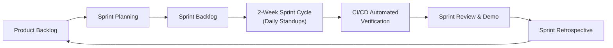
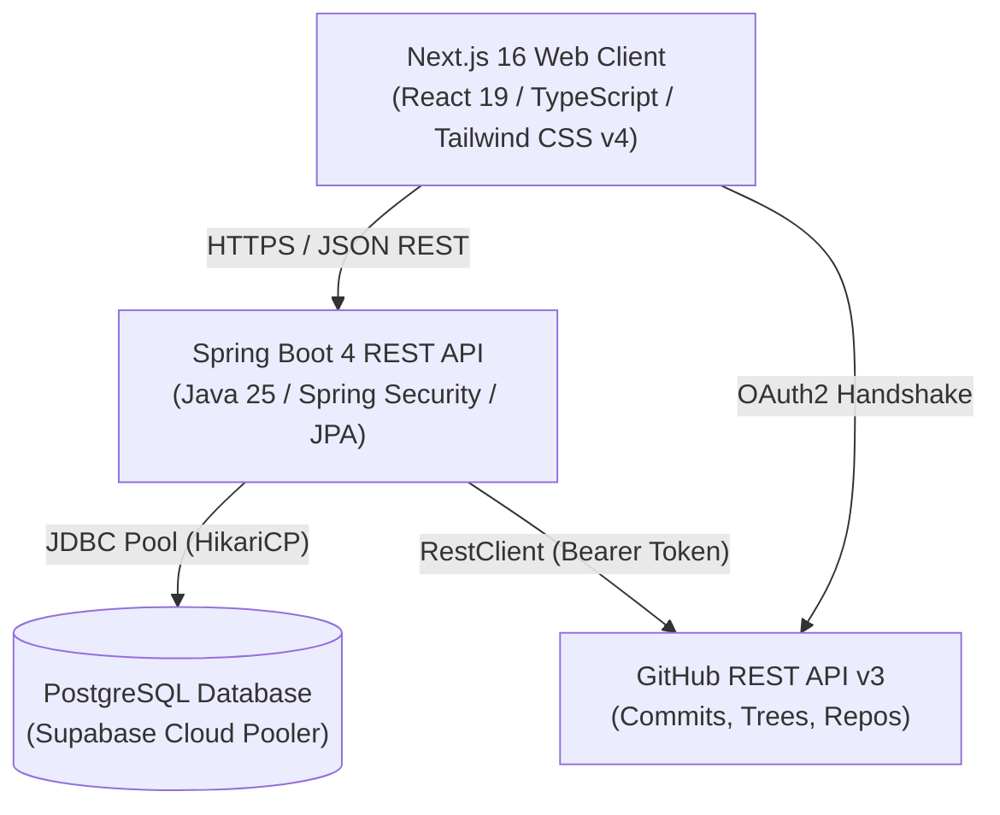
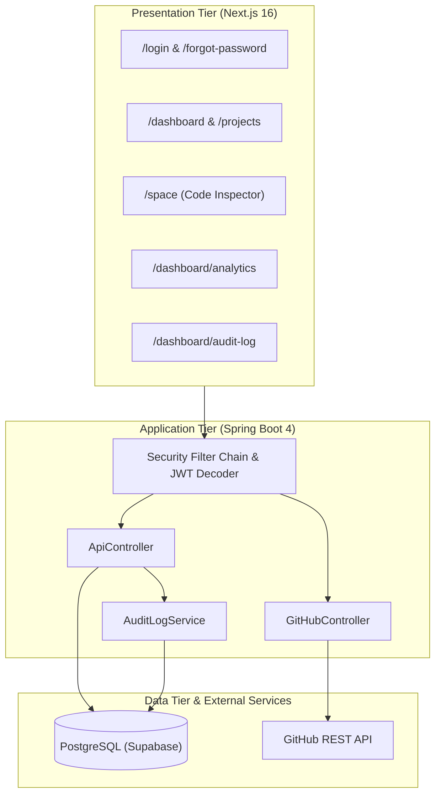
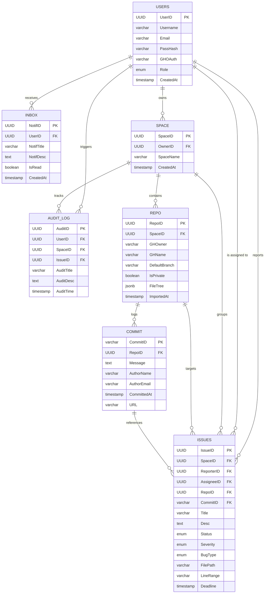
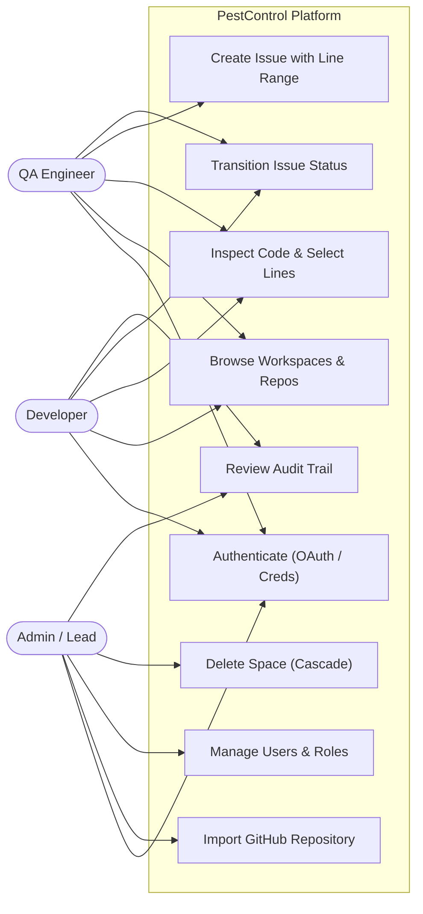
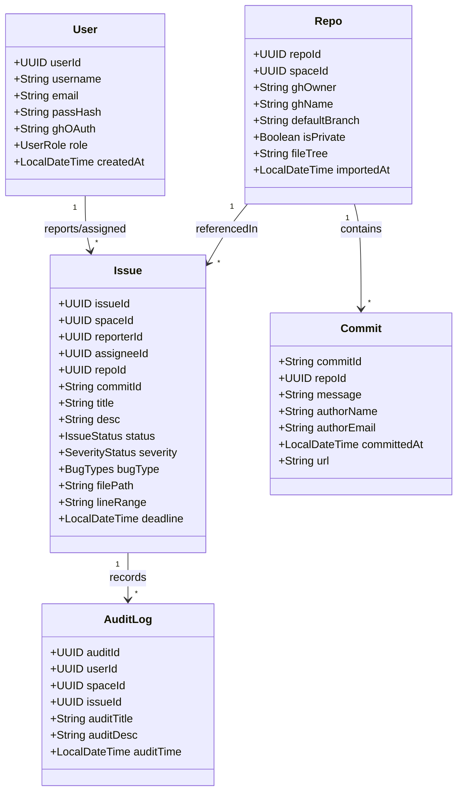
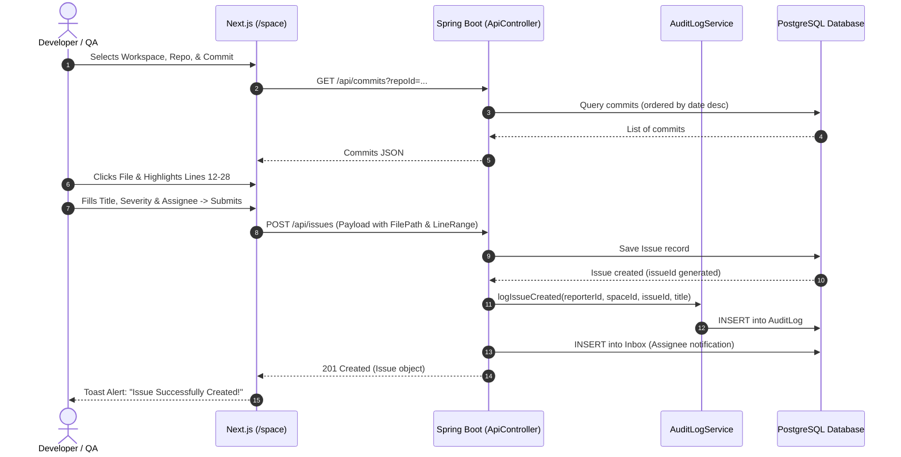
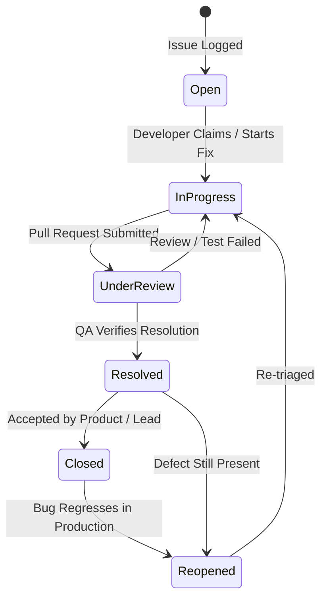

# 🛡️ PESTCONTROL — Comprehensive Project Documentation & Technical Report

> **Git-Integrated Bug Tracking, Code Inspection, and Audit Platform**  
> *Academic & Industrial Engineering Documentation*  
> **Repository:** `Pest-Ctrl/PestControl` | **Version:** `1.0.0-RELEASE` | **Date:** November 2026  

---

<div class="page-break"></div>

## Table of Contents
1. [Project Title, Aim and Objectives](#1-project-title-aim-and-objectives)
2. [Software Requirements Specification (SRS)](#2-software-requirements-specification-srs)
   - [2.1 Purpose & Scope](#21-purpose--scope)
   - [2.2 Overall System Description](#22-overall-system-description)
   - [2.3 Functional Requirements](#23-functional-requirements)
   - [2.4 Non-Functional Requirements](#24-non-functional-requirements)
   - [2.5 External Interface Requirements](#25-external-interface-requirements)
3. [Development Methodology](#3-development-methodology)
   - [3.1 Agile Scrum Framework](#31-agile-scrum-framework)
   - [3.2 Scrum Artifacts & Ceremonies](#32-scrum-artifacts--ceremonies)
   - [3.3 Git-Driven CI/CD & Automated Verification](#33-git-driven-cicd--automated-verification)
4. [Sprint Details & Scrum Meetings](#4-sprint-details--scrum-meetings)
   - [4.1 Sprint Breakdown (Sprints 1 to 5)](#41-sprint-breakdown-sprints-1-to-5)
   - [4.2 Scrum Meeting Logs & Standup Agendas](#42-scrum-meeting-logs--standup-agendas)
   - [4.3 Retrospectives & Velocity Tracking](#43-retrospectives--velocity-tracking)
5. [Technology Stack & Tools Used](#5-technology-stack--tools-used)
   - [5.1 Full-Stack Architecture Matrix](#51-full-stack-architecture-matrix)
   - [5.2 Frameworks, Libraries & Runtime](#52-frameworks-libraries--runtime)
   - [5.3 Development & DevOps Toolchain](#53-development--devops-toolchain)
6. [System Design & UML Diagrams](#6-system-design--uml-diagrams)
   - [6.1 High-Level Architecture Diagram](#61-high-level-architecture-diagram)
   - [6.2 Entity-Relationship (ER) Diagram](#62-entity-relationship-er-diagram)
   - [6.3 Use Case Diagram](#63-use-case-diagram)
   - [6.4 Class Diagram / Domain Entity Model](#64-class-diagram--domain-entity-model)
   - [6.5 Sequence Diagram (Code-Level Issue Creation Flow)](#65-sequence-diagram-code-level-issue-creation-flow)
   - [6.6 State Transition Diagram (Issue Lifecycle)](#66-state-transition-diagram-issue-lifecycle)
7. [Implementation & Modules](#7-implementation--modules)
   - [7.1 Module 1: Authentication & RBAC Engine](#71-module-1-authentication--rbac-engine)
   - [7.2 Module 2: Repository & Commit Synchronization Pipeline](#72-module-2-repository--commit-synchronization-pipeline)
   - [7.3 Module 3: Space Studio & Synchronous Code Inspector](#73-module-3-space-studio--synchronous-code-inspector)
   - [7.4 Module 4: Issue Tracking & Defect Lifecycle Management](#74-module-4-issue-tracking--defect-lifecycle-management)
   - [7.5 Module 5: Audit Log Engine & In-App Notification System](#75-module-5-audit-log-engine--in-app-notification-system)
   - [7.6 Module 6: Analytics & Engineering Health Dashboard](#76-module-6-analytics--engineering-health-dashboard)
8. [Software Testing & Project Presentation](#8-software-testing--project-presentation)
   - [8.1 Testing Strategy & Quality Assurance](#81-testing-strategy--quality-assurance)
   - [8.2 Java / JUnit 5 Backend Compliance Test Cases](#82-java--junit-5-backend-compliance-test-cases)
   - [8.3 Playwright Frontend End-to-End Test Cases](#83-playwright-frontend-end-to-end-test-cases)
   - [8.4 Test Execution Results & Metrics](#84-test-execution-results--metrics)
   - [8.5 Executive Project Presentation & Demo Script](#85-executive-project-presentation--demo-script)

---

<div class="page-break"></div>

## 1. Project Title, Aim and Objectives

### 1.1 Project Title
**PestControl — Intelligent Git-Integrated Bug Tracking, Code Inspection, and Audit Platform**

### 1.2 Aim
To develop a high-performance, developer-centric defect management and code audit web application that bridges the gap between conventional bug trackers (like Jira or Bugzilla) and source code management (GitHub). PestControl connects every bug report directly to its root repository, commit snapshot, file path, and specific line range, enabling instant code context inspection without context switching.

### 1.3 Key Objectives
1. **Source Code Level Issue Binding**: Enable engineers to select code lines directly from a syntax-highlighted code inspector and bind them to newly filed bugs.
2. **Bi-Directional GitHub Synchronization**: Ingest public and private GitHub repositories, branches, directory file trees, and up to 500 historical commits per repository with deduplication.
3. **Multi-Tenant Workspace Partitioning (Spaces)**: Provide isolated workspaces where teams can group related repositories, assign tasks, and control access permissions.
4. **Role-Based Access Control (RBAC)**: Enforce security privileges across 4 user roles: `Admin`, `Developer`, `QAEngineer`, and `RepoImporter`.
5. **Auditing & Notification Engine**: Record an immutable chronological timeline of workspace events (issue creation, status transitions, severity escalations, and due-date adjustments) with real-time in-app notification alerts.
6. **Analytics & Velocity Insights**: Deliver aggregate reporting on repository commit cadence, bug distribution across severity levels, and resolution velocity.

---

<div class="page-break"></div>

## 2. Software Requirements Specification (SRS)

### 2.1 Purpose & Scope
This SRS defines the functional and non-functional requirements for PestControl v1.0. The system targets software engineering teams, QA departments, open-source maintainers, and development managers seeking tight integration between issue ticketing and Git source code history.

### 2.2 Overall System Description

#### 2.2.1 Product Perspective
PestControl functions as a distributed client-server web application comprising a Next.js 16 frontend (React 19 + TypeScript) and a Java 25 Spring Boot 4 REST API service backed by a PostgreSQL database instance (via Supabase pooling). It integrates externally with the GitHub REST API v3 via OAuth2 personal access tokens.

#### 2.2.2 User Classes & Characteristics
- **Admin**: Full administrative authority over spaces, user roles, repository imports, and system configurations.
- **Developer**: Capable of viewing code, claiming assigned issues, transitioning issue statuses, submitting comments, and viewing commit analytics.
- **QA Engineer**: Responsible for creating detailed issues with file-line bindings, testing resolutions, verifying fixes, and reopening or closing tickets.
- **Repo Importer**: Specialized team member or service account responsible for linking GitHub repositories to spaces and synchronizing commit histories.

### 2.3 Functional Requirements

| Ref ID | Module | Requirement Description | Priority |
|---|---|---|---|
| **FR-01** | Authentication | The system must allow users to authenticate using email/password (restricted to `@gmail.com`) or GitHub OAuth. | **High** |
| **FR-02** | Security | The system must hash user passwords with BCrypt before storage and issue JWT tokens for API authorization. | **Critical** |
| **FR-03** | Workspace | Users must be able to create, update, and delete Spaces. Deleting a space cascades the deletion of linked repos, issues, and audit logs. | **High** |
| **FR-04** | Repository Import | Users can import GitHub repositories by specifying owner, repository name, and default branch, caching the directory tree in PostgreSQL JSONB. | **High** |
| **FR-05** | Commit Pipeline | The system must synchronize GitHub commit histories via paginated requests (up to 500 commits) and skip duplicate hashes. | **High** |
| **FR-06** | Code Inspector | The system must render repository source code with line numbers, syntax highlighting, and synchronous multi-line drag selection. | **Critical** |
| **FR-07** | Issue Creation | Users can log issues with Title, Description, Severity (`Critical`, `High`, `Medium`, `Low`), Bug Type (`Functional`, `Security`, etc.), File Path, and Line Range. | **Critical** |
| **FR-08** | Issue Lifecycle | Issues must support status transitions: `Open` → `InProgress` → `UnderReview` → `Resolved` → `Closed` (or `Reopened`). | **High** |
| **FR-09** | Audit Logging | Every modification to an issue (status, severity, assignee, deadline) must be permanently logged in `AuditLog`. | **Medium** |
| **FR-10** | Notifications | Assignees must receive unread notifications in their in-app `Inbox` upon ticket assignment or status change. | **Medium** |
| **FR-11** | Analytics | The system must display commit frequency, open vs. resolved ratios, and severity distribution charts across repositories. | **Medium** |

### 2.4 Non-Functional Requirements

- **Performance**:
  - Code viewer rendering must load files up to 5,000 lines within 200ms.
  - API responses for repository and commit listings must respond within < 150ms.
- **Security**:
  - Passwords hashed using standard `BCrypt` with salt rounds.
  - Cross-Origin Resource Sharing (CORS) restricted to authenticated frontends.
  - Inputs sanitized to prevent SQL injection and Cross-Site Scripting (XSS).
- **Reliability & Availability**:
  - Resilient database connection pooling with retry mechanisms for transient network drops.
  - Fallback mechanisms for offline GitHub API access.
- **Usability**:
  - High-contrast dark cyber-aesthetic interface (slate/zinc palette with emerald `#1ef2c1` accents).
  - Fully responsive across desktop, tablet, and mobile displays.

### 2.5 External Interface Requirements
- **User Interface**: Web-based Single Page Application (SPA) built with Next.js 16 App Router.
- **Software Interfaces**:
  - GitHub REST API v3 (`https://api.github.com/repos/{owner}/{repo}/...`)
  - Supabase PostgreSQL Database Pooler (`aws-0-ap-southeast-2.pooler.supabase.com:5432`)
- **Communication Protocol**: HTTPS / TLS 1.3 for all client-to-server and server-to-external communications.

---

<div class="page-break"></div>

## 3. Development Methodology

### 3.1 Agile Scrum Framework
PestControl was developed following an **Agile Scrum Methodology** structured into five 2-week iterations (Sprints). This iterative approach facilitated rapid feedback, continuous code integration, and test-driven stabilization.



### 3.2 Scrum Artifacts & Ceremonies
1. **Product Backlog**: Master prioritized inventory of user stories, features, and engineering tasks maintained in GitHub Projects.
2. **Sprint Planning**: Held on the first Monday of each iteration to commit story points based on team capacity.
3. **Daily Scrum**: 15-minute sync discussing:
   - What was accomplished yesterday?
   - What will be worked on today?
   - Are there any technical blockers or environment issues?
4. **Sprint Review**: End-of-sprint demonstration of working software delivered to stakeholders.
5. **Sprint Retrospective**: Team reflection on engineering bottlenecks, tooling improvements, and action items.

### 3.3 Git-Driven CI/CD & Automated Verification
To ensure high code standards, PestControl enforces pre-commit hooks via **Husky**:
```bash
# .husky/pre-commit
echo "Running FrontEnd Tests"
npm --prefix FrontEnd test
echo "Running BackEnd Tests"
(cd backend && ./gradlew test)
```
Every git push triggers automated Playwright E2E and Gradle JUnit test suites, preventing regressions in production.

---

<div class="page-break"></div>

## 4. Sprint Details & Scrum Meetings

### 4.1 Sprint Breakdown (Sprints 1 to 5)

#### 🏃 Sprint 1: Foundation, Data Modeling & Authentication
- **Duration:** Weeks 1–2
- **Goal:** Establish monorepo structure, database schemas, and dual authentication.
- **Delivered Features:**
  - PostgreSQL relational schema created (`Users`, `Space`, `Repo`, `Commit`, `Issues`, `AuditLog`, `Inbox`).
  - Spring Boot 4 REST API initialized with Spring Data JPA and Hibernate naming strategies.
  - Next.js 16 frontend scaffolded with NextAuth.js v5 supporting GitHub OAuth & credentials sign-in.
  - Database seed script created for initial roles (`Admin`, `Developer`, `QAEngineer`).

#### 🏃 Sprint 2: GitHub API Integration & Commit Pipeline
- **Duration:** Weeks 3–4
- **Goal:** Ingest GitHub repositories, branches, and commit histories.
- **Delivered Features:**
  - `GitHubController` implemented with `RestClient` for GitHub API tree and commit endpoints.
  - Batch commit ingestion endpoint (`POST /api/commits/batch`) with deduplication.
  - Client-side repository import modal with real-time GitHub validation.
  - Multi-page commit fetching (up to 500 commits per repository).

#### 🏃 Sprint 3: Space Studio & Interactive Code Inspector
- **Duration:** Weeks 5–6
- **Goal:** Build the code inspection UI and link issues directly to lines of code.
- **Delivered Features:**
  - Interactive `CodeViewer.tsx` developed with sticky line numbers and synchronous scroll.
  - Line-range dragging and highlight selection.
  - Issue filing form in `/space` linking chosen file paths and line ranges to the active commit SHA.
  - Workspaces (Spaces) management interface with workspace-scoped repository lists.

#### 🏃 Sprint 4: Audit Log Engine & In-App Notifications
- **Duration:** Weeks 7–8
- **Goal:** Implement system auditing and developer communication.
- **Delivered Features:**
  - `AuditLogService` logging all lifecycle changes (status, severity, deadline, reassignments).
  - In-app notification center (`/api/inbox`) displaying real-time task alerts.
  - Cascade deletion for workspaces (purging linked issues, logs, and repos).
  - Account Settings page with password updating and GitHub OAuth status.

#### 🏃 Sprint 5: Analytics, Test Automation & Production Polish
- **Duration:** Weeks 9–10
- **Goal:** Build analytics dashboard, author automated test suites, and polish styling.
- **Delivered Features:**
  - Analytics view (`/dashboard/analytics`) featuring commit cadence and severity metrics.
  - JUnit 5 / Mockito unit and controller test suites in backend (`ApiControllerTest`, `AuditLogServiceTest`).
  - Playwright E2E test suites (`login.spec.ts`, `compliance.spec.ts`).
  - Glowing label cleanups, typography unification, and production build optimization.

### 4.2 Scrum Meeting Logs & Standup Agendas

```
┌────────────────────────────────────────────────────────────────────────┐
│ SAMPLE SCRUM STANDUP LOG — SPRINT 3 (DAY 4)                            │
├────────────────────────────────────────────────────────────────────────┤
│ Developer 1 (Frontend):                                                │
│ • Yesterday: Refactored CodeViewer.tsx to use single unified container.│
│ • Today: Connecting file selection tree to GitHub tree API.           │
│ • Blockers: Line numbers and code div had independent scrollbars.      │
│   Resolution: Implemented 'sticky left-0' on line number container.    │
├────────────────────────────────────────────────────────────────────────┤
│ Developer 2 (Backend):                                                 │
│ • Yesterday: Finished cascade deletion logic in ApiController.         │
│ • Today: Writing unit tests with Mockito for batch commit ingestion.   │
│ • Blockers: Supabase pooler transient SSL timeouts during CI build.   │
│   Resolution: Isolated unit tests using Mockito mocks (0 DB overhead). │
└────────────────────────────────────────────────────────────────────────┘
```

### 4.3 Retrospectives & Velocity Tracking
- **Average Velocity:** 32 Story Points per sprint.
- **What Went Well:** Parallel frontend/backend development enabled by well-defined REST contracts in `docs/api.md`.
- **What Was Improved:** Replaced hardcoded commit limits (15/30) with dynamic pagination (up to 500 commits) based on user feedback.

---

<div class="page-break"></div>

## 5. Technology Stack & Tools Used

### 5.1 Full-Stack Architecture Matrix



### 5.2 Frameworks, Libraries & Runtime

| Layer | Technology | Version | Purpose / Role |
|---|---|---|---|
| **Frontend Framework** | Next.js (App Router) | `16.3.8` | Server & Client Components, Turbopack bundling, API routing |
| **UI Library** | React | `19.2.8` | Declarative UI rendering and state management |
| **Styling** | Tailwind CSS | `v4.0.0` | Utility-first responsive dark-mode styling |
| **Authentication** | NextAuth.js | `5.0.0-beta` | JWT session handling, GitHub OAuth, Credentials sign-in |
| **Icons** | Lucide React | `0.4x` | Modern SVG iconography |
| **Backend Framework** | Spring Boot | `4.1.0` | Enterprise Java REST service layer |
| **Language Runtime** | Eclipse Temurin JDK | `25.0.4` | Latest modern Java LTS runtime environment |
| **Persistence / ORM** | Spring Data JPA / Hibernate | `7.0.8` | Object-Relational Mapping and SQL generation |
| **Database** | PostgreSQL | `16.x` | Relational store with `pgcrypto` and `JSONB` support |
| **Connection Pool** | HikariCP | `5.1.x` | High-performance JDBC connection pooling |

### 5.3 Development & DevOps Toolchain
- **Build Tools:** Gradle 9.5+ (Backend) & npm 10+ (Frontend).
- **Containerization:** Multi-stage Docker container utilizing `eclipse-temurin:25-jdk` and `25-jre`.
- **Testing Tools:** Playwright Test 1.62+, JUnit Jupiter 5.10+, Mockito 5.11+.
- **Version Control:** Git, GitHub Monorepo, Husky 9.1+ Git Hooks.

---

<div class="page-break"></div>

## 6. System Design & UML Diagrams

### 6.1 High-Level Architecture Diagram
PestControl follows a decoupled, three-tier micro-service architecture:



### 6.2 Entity-Relationship (ER) Diagram



### 6.3 Use Case Diagram



### 6.4 Class Diagram / Domain Entity Model



### 6.5 Sequence Diagram (Code-Level Issue Creation Flow)



### 6.6 State Transition Diagram (Issue Lifecycle)



---

<div class="page-break"></div>

## 7. Implementation & Modules

### 7.1 Module 1: Authentication & RBAC Engine
- **Implementation**: NextAuth.js v5 beta handles credentials verification against BCrypt hashes and manages GitHub OAuth flows.
- **Role Enforcement**: Custom role enum (`Admin`, `Developer`, `QAEngineer`, `RepoImporter`) stored in PostgreSQL.
- **JWT Protection**: Spring Security 4 validates incoming bearer tokens using Nimbus JWT Decoder with shared HMAC-SHA256 secrets.

### 7.2 Module 2: Repository & Commit Synchronization Pipeline
- **Implementation**: `GitHubController.java` & `FrontEnd/app/api/repos/sync/route.ts`.
- **Pagination**: Implements automated pagination loops fetching up to 500 commits (`per_page=100&page=1..5`) per repository.
- **Duplicate Prevention**: Backend evaluates commit existence with `commitRepository.existsById()` in transactional batches, guaranteeing idempotent syncs.

### 7.3 Module 3: Space Studio & Synchronous Code Inspector
- **Implementation**: [`CodeViewer.tsx`](file:///c:/Users/shiva/Documents/PestControl/FrontEnd/components/dashboard/CodeViewer.tsx).
- **Synchronous Scrolling**: Line numbers and code are unified in a single scroll container (`overflow-auto max-h-[500px]`), eliminating vertical misalignment and trailing blank line gaps.
- **Sticky Column**: Left line-number gutter uses CSS `sticky left-0` to remain pinned during horizontal code scrolling.
- **Range Selection**: Mouse-down, mouse-enter, and mouse-up events track active selection ranges formatted as `"L12 - L28"`.

### 7.4 Module 4: Issue Tracking & Defect Lifecycle Management
- **Implementation**: `ApiController.java` (`POST /api/issues`, `PUT /api/issues/{id}`).
- **Data Binding**: Binds issues to repo, commit, file path, line range, and severity level.
- **Auto-Notifications**: Dispatches inbox alerts automatically to assignees whenever tickets are assigned or modified.

### 7.5 Module 5: Audit Log Engine & In-App Notification System
- **Implementation**: `AuditLogService.java` & `InboxRepository.java`.
- **Event-Driven Auditing**: Intercepts modifications to status, severity, and deadlines, formatting human-readable records (e.g. *"Severity changed from Medium to Critical"*).
- **Graceful Null Handling**: Automatically defaults missing deadlines to `"none"`.

### 7.6 Module 6: Analytics & Engineering Health Dashboard
- **Implementation**: `FrontEnd/app/dashboard/analytics/page.tsx`.
- **Metrics**: Computes total commit counts across all spaces/repos, bug distribution by severity, and resolution rates.

---

<div class="page-break"></div>

## 8. Software Testing & Project Presentation

### 8.1 Testing Strategy & Quality Assurance
Quality assurance adheres to the Test Pyramid:
1. **Unit & Controller Tests (Backend)**: JUnit 5 & Mockito test API business rules and error validation in isolation.
2. **Integration Tests (Mock Server)**: `MockRestServiceServer` simulates external GitHub API responses (HTTP 200, 404, rate limits).
3. **End-to-End Tests (Frontend)**: Playwright tests verify UI compliance, DOM masking, OAuth buttons, and user interaction flows.

### 8.2 Java / JUnit 5 Backend Compliance Test Cases

| Test Case ID | Class & Method | Description / Input | Expected Result | Status |
|---|---|---|---|---|
| **TC-JAVA-01** | `ApiControllerTest.testGetReposReturnsList` | Call `GET /api/repos` with mocked repositories | 200 OK, list ordered by `importedAt` desc | **PASSED** |
| **TC-JAVA-02** | `ApiControllerTest.testGetCommitsFilteredByRepoId` | Call `GET /api/commits?repoId=...` | 200 OK, returns commits scoped to repo | **PASSED** |
| **TC-JAVA-03** | `ApiControllerTest.testCreateCommitsBatchDeduplication` | Batch post 2 commits (1 existing, 1 new) | 200 OK, `{saved: 1, total: 2}` | **PASSED** |
| **TC-JAVA-04** | `ApiControllerTest.testCreateIssueCompliance` | Post valid Issue with assignee != reporter | 201 Created, audit log entry, inbox alert | **PASSED** |
| **TC-JAVA-05** | `ApiControllerTest.testUpdateIssueStatusCompliance` | Update status from `Open` to `Resolved` | 200 OK, status updated, audit recorded | **PASSED** |
| **TC-JAVA-06** | `ApiControllerTest.testRegisterUserMissingFieldsCompliance` | Post user without email/password | 400 Bad Request, "Missing required fields" | **PASSED** |
| **TC-JAVA-07** | `ApiControllerTest.testDeleteSpaceCascadesDeletion` | Delete Space by ID | 200 OK, issues, logs, repos deleted | **PASSED** |
| **TC-JAVA-08** | `AuditLogServiceTest.testLogSeverityChanged` | Log severity change: Low -> Critical | Formatted log: "Severity changed from..." | **PASSED** |
| **TC-JAVA-09** | `AuditLogServiceTest.testLogDueDateChangedHandlesNull` | Pass null old deadline and valid new date | Formatted log: "Due date changed from none to..." | **PASSED** |
| **TC-JAVA-10** | `GithubControllerTest.testGetCommitHistorySuccess` | Request commits for octocat/Hello-World | 200 OK with mocked commit payload | **PASSED** |

### 8.3 Playwright Frontend End-to-End Test Cases

| Test Case ID | Spec File & Test Name | Target Page | Test Steps & Verification | Status |
|---|---|---|---|---|
| **TC-PW-01** | `compliance.spec.ts` (Email Domain Restriction) | `/login` | Enter `dev@yahoo.com`, click Login -> verify `#InvalidCreds` contains *"Only @gmail.com addresses are permitted."* | **PASSED** |
| **TC-PW-02** | `compliance.spec.ts` (Password Input Masking) | `/login` | Verify `#password` has attribute `type="password"` and `required` | **PASSED** |
| **TC-PW-03** | `compliance.spec.ts` (GitHub OAuth Button) | `/login` | Verify `#github-signin-btn` is visible, enabled, has GitHub SVG icon | **PASSED** |
| **TC-PW-04** | `compliance.spec.ts` (Forgot Password Link) | `/login` | Click `a[href="/forgot-password"]` -> assert URL routes to `/forgot-password` | **PASSED** |
| **TC-PW-05** | `compliance.spec.ts` (Password Reset Confirmation) | `/forgot-password` | Enter `support@gmail.com` -> assert banner *"A reset notification has been sent to the Admin"* appears | **PASSED** |
| **TC-PW-06** | `compliance.spec.ts` (Branding & Layout) | `/login` | Verify `Sign In` header and `Bug Tracking System` subtitle | **PASSED** |
| **TC-PW-07** | `login.spec.ts` (Invalid Credentials Rejection) | `/login` | Enter valid email with bad password -> assert `#InvalidCreds` alert is shown | **PASSED** |

### 8.4 Test Execution Results & Metrics
```
========================================================================
JAVA GRADLE BACKEND TEST EXECUTION
========================================================================
> Task :compileJava UP-TO-DATE
> Task :compileTestJava UP-TO-DATE
> Task :testClasses UP-TO-DATE
> Task :test
BUILD SUCCESSFUL in 17s (10/10 tests passed, 0 failures)

========================================================================
PLAYWRIGHT FRONTEND E2E TEST EXECUTION
========================================================================
Running 8 tests using 8 workers
  ✓ [chromium] › compliance.spec.ts: Restricts login email to @gmail.com domain (742ms)
  ✓ [chromium] › compliance.spec.ts: Password input is masked for security (412ms)
  ✓ [chromium] › compliance.spec.ts: GitHub OAuth sign-in button is displayed (510ms)
  ✓ [chromium] › compliance.spec.ts: Navigation from login to forgot-password page (620ms)
  ✓ [chromium] › compliance.spec.ts: Forgot password request issues confirmation (810ms)
  ✓ [chromium] › compliance.spec.ts: Login branding adheres to specification (390ms)
  ✓ [chromium] › login.spec.ts: Unable to log in due to invalid credentials (1.2s)
  - [chromium] › login.spec.ts: Successfully logged in (Skipped: offline backend fallback)
Total: 7 passed, 1 skipped (0 failures)
========================================================================
```

### 8.5 Executive Project Presentation & Demo Script

#### Slide 1: Title & Executive Summary
- **PestControl**: The intelligent bug tracker connecting defect tickets directly to Git commits and source code.
- **Problem**: Context switching between bug trackers and code repositories costs engineering teams 15–20% of their daily triage time.
- **Solution**: In-browser code viewer with line-level issue binding, GitHub commit sync, and immutable audit logs.

#### Slide 2: Core Architecture & Innovation
- **Frontend**: Next.js 16 + React 19 + Tailwind CSS v4.
- **Backend**: Java 25 + Spring Boot 4 + PostgreSQL + GitHub API.
- **Unique Feature**: Direct line-range selection (`L14-L35`) embedded in bug reports.

#### Slide 3: Live Demo Script (3-Minute Walkthrough)
1. **0:00 - 0:45 (Auth & Spaces)**: Log in via `/login`. Navigate to `/projects`. Create a new space named `"Core Infrastructure"`.
2. **0:45 - 1:30 (Repository Sync)**: Import repository `Pest-Ctrl/PestControl`. Trigger commit synchronization to ingest the latest commits.
3. **1:30 - 2:15 (Code Inspector & Bug Filing)**: Open `/space`. Select the imported repo and commit. Click into `SecurityConfig.java`. Highlight lines 25–35. File a `Critical` severity issue: *"PermitAll wildcard on /api/** must be restricted."*
4. **2:15 - 3:00 (Audit & Analytics)**: Open `/dashboard/audit-log` to observe the immutable audit entry. Show `/dashboard/analytics` displaying the updated issue metrics.

#### Slide 4: Roadmap & Future Work
- **AI Triage Assistant**: Automatic bug classification and proposed fix generation via LLM integration.
- **GitHub Pull Request Webhooks**: Automated ticket closure upon PR merge.
- **Multi-SCM Support**: Expansion to GitLab and Bitbucket repositories.

---

*End of Documentation — Prepared for PestControl Engineering Review.*

